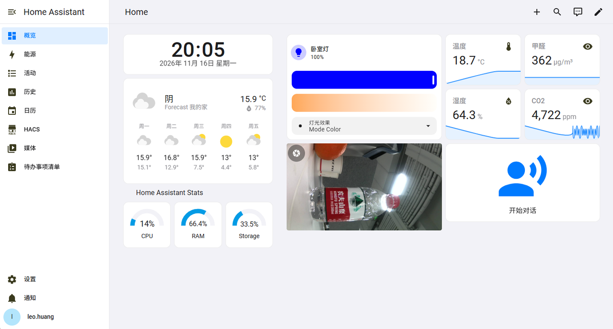

# Smart Home Box

English | [中文](README_zh.md)

This project is a smart home box demo built on the
[Quectel Pi](https://www.quectel.com.cn/quectel-pi/documentation-center) main control board.
It is based on the open-source Home Assistant platform and combines smart lights, air
quality sensors and a camera to provide device onboarding and control, voice interaction,
video surveillance, data reporting and multi-device automation.



## Features

- Unified control and management of sensors, smart lights and camera devices
- Control smart light states through voice conversation
- Real-time acquisition of temperature, humidity, PM2.5 and formaldehyde data, displayed in the UI
- Camera monitoring with fire/smoke detection and face detection, able to trigger voice announcements and alarm notifications
- Periodic weekly summary of device operation data, pushed to Feishu (Lark)
- Multi-device automation linking formaldehyde alarms and face detection alerts

## Hardware Requirements

- Quectel Pi M2
- Air quality sensor
- Wi-Fi smart light
- USB camera
- Audio output device (speaker or earphones)

## Software Requirements

- Debian 13 (default system on Quectel Pi M2)
- RKNN runtime `librknnrt.so` **2.3.2**
- `gcc` compiler and docker installed on the board
- Python 3 and GStreamer runtime libraries (including the Rockchip plugins)
- RKNN, RGA, MPP and JPEG runtime libraries on the board
- mqtt, home_assistant, lva, piper and sense_voice services deployed on the board (see `scripts/`)

The RKNN header files, the on-board runtime and the model conversion tools must all use
exactly **2.3.2**.

| Component | Required version |
| --- | --- |
| `librknnrt.so` on the board | 2.3.2 |
| `rknn_api.h` used for building | 2.3.2 |

### Build, Deploy and Run

1. Open a terminal on the main control board and clone the project.

```bash
sudo apt update
sudo apt install -y git
git clone https://github.com/Quectel-Pi/demo-smart-home-box.git
```

A `demo-smart-home-box` directory is created in the current directory.

2. Run the following commands on the board. The message `Deployment complete` means the
   deployment finished successfully.

```bash
cd demo-smart-home-box
sudo chmod 755 install.sh
./install.sh
```

`install.sh` can also deploy only one part:

```bash
sudo ./install.sh sensor    # 21VOC sensor only
sudo ./install.sh camera    # camera only
```

If `./install.sh` fails, or `Deployment complete` is not printed, do not continue with the
following steps. Verify the network connection first, then re-run `install.sh` from the
project root.

3. Enable the programs at boot and start them.

```bash
cd demo-smart-home-box
sudo chmod 755 setup_autostart.sh
./setup_autostart.sh install
```

4. Verify the services.

```bash
./setup_autostart.sh status          # service status (no root required)
journalctl -u camera -f              # camera logs
journalctl -u 21voc -f               # sensor logs
```

Once the camera is running, open `http://<board-ip>:8080/video` in a browser to view the
live stream with detection overlays.

MQTT credentials are configured in `/etc/homebox/camera.env` and must match the account
configured in the mosquitto broker on the board. Run `sudo systemctl restart camera` after
changing them.

## Project Structure

```
demo-smart-home-box
├── LICENSE
├── README.md
├── README_zh.md
├── doc
│   └── assets
├── install.sh # deployment script
├── scripts # configuration files for the docker services
│   ├── camera # test script for the camera pipeline
│   ├── home_assistant
│   ├── lva # startup script for the lva service
│   ├── mqtt
│   ├── piper
│   └── sense_voice
├── setup_autostart.sh  # enables the programs at system boot
└── src
    ├── 21voc_sensor # sensor sampling and reporting source
    └── camera # camera monitoring source
```

## Reporting Issues

If you run into problems, feel free to ask on the
[Quectel official forum](https://forumschinese.quectel.com/c/quectel-pi/58); our support
team will get back to you.
Issues and pull requests that improve this project are welcome.
