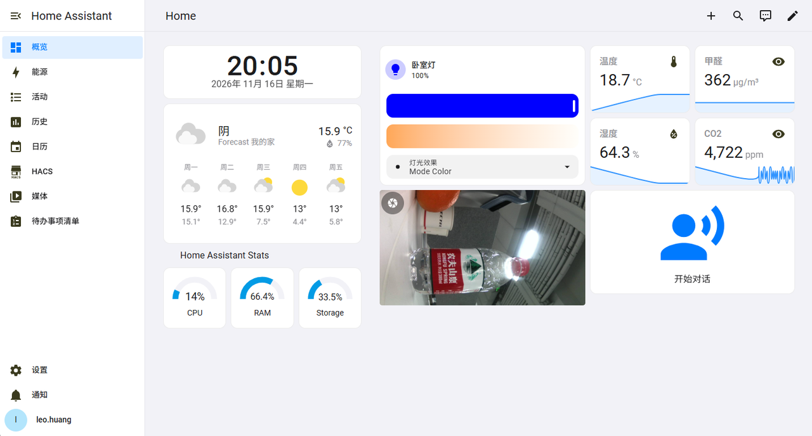

# 家庭盒子

[English](README.md) | 中文

本项目是一个基于 [Quectel Pi 智能主控板](https://www.quectel.com.cn/quectel-pi/documentation-center)实现的家庭盒子示例。
系统基于开源的HomeAssistant智能家居平台，结合智能灯，空气传感器，摄像头等，实现智能家居的设备接入和控制，语音交互，以及视频监控，数据推送和多设备联动功能。



## 功能特性

- 接入传感器，智能灯，摄像头设备，实现统一控制和管理
- 语音对话控制智能灯设备的状态切换
- 实时采集传感器的温湿度，PM2.5，甲醛等数据，在界面上显示
- 摄像头监控支持火焰检测和人脸检测，并可触发语音播报和告警信息推送
- 定时汇总一周设备运行的数据，生成周报推送到飞书通知
- 实现甲醛超标和摄像头人脸检测的告警多设备联动

## 硬件要求

- Quectel Pi M2
- 空气传感器
- WIFI智能灯 
- USB 摄像头
- 音频输出设备（扬声器或耳机）  

## 软件要求

- Debian 13（Quectel Pi M2 默认系统）
- RKNN 运行时 `librknnrt.so` **2.3.2**
- 板上安装 `gcc` 编译器和 docker
- Python 3 以及 GStreamer 运行库（含 Rockchip 插件）
- 板上 RKNN、RGA、MPP 和 JPEG 运行库
- 板上已部署 mqtt、home_assistant、lva、piper、sense_voice 服务（见 `scripts/`）

RKNN 头文件、板上运行时和模型转换工具必须统一使用 **2.3.2**。

| 组件 | 要求版本 |
| --- | --- |
| 板上 `librknnrt.so` | 2.3.2 |
| 编译使用的 `rknn_api.h` | 2.3.2 |

### 编译，部署和运行

1.在智能主控板上打开终端，使用 git 克隆项目代码。

```bash
sudo apt update
sudo apt install -y git
git clone https://github.com/Quectel-Pi/demo-smart-home-box.git
```

执行完成后，当前目录下应生成`demo-smart-home-box`文件夹。

2.在智能主控板的终端下依次执行下面命令，终端显示`Deployment complete`则说明部署完成。

```bash
cd demo-smart-home-box
sudo chmod 755 install.sh
./install.sh
```

`install.sh` 支持按需部署，只装其中一个时用：

```bash
sudo ./install.sh sensor    # 只部署 21VOC 传感器
sudo ./install.sh camera    # 只部署摄像头
```

如果执行`./install.sh`过程中报错，或终端未显示"Deployment complete"，请先不要继续执行后续步骤。建议先确认网络连接正常，再返回项目根目录重新执行一次`install.sh`。

3.配置程序开机自启动，并运行程序

```bash
cd demo-smart-home-box
sudo chmod 755 setup_autostart.sh
./setup_autostart.sh install
```

4.验证服务

```bash
./setup_autostart.sh status          # 查看两个服务状态
journalctl -u camera -f              # 查看摄像头日志
journalctl -u 21voc -f               # 查看传感器日志
```

摄像头启动后，浏览器打开 `http://<板子IP>:8080/video` 即可查看带检测框的实时画面。

MQTT 账号配置在 `/etc/homebox/camera.env`，需与板上 mosquitto 的账号一致，改完执行
`sudo systemctl restart camera` 生效。

## 项目结构

```
demo-smart-home-box
├── LICENSE
├── README.md
├── README_zh.md
├── doc
│   └── assets
├── install.sh #程序部署脚本
├── scripts # docker服务的配置文件
│   ├── camera # camera通路的测试脚本
│   ├── home_assistant
│   ├── lva # lva服务的启动脚本
│   ├── mqtt
│   ├── piper
│   └── sense_voice
├── setup_autostart.sh  # 配置程序系统开机自启的脚本
└── src
    ├── 21voc_sensor #传感器采集上报源码
    └── camera #摄像头监控源码
```

## 报告问题
如在使用过程中遇到问题，欢迎在[移远官方论坛](https://forumschinese.quectel.com/c/quectel-pi/58) 提交技术咨询，我们的技术支持团队将及时为您解答。
欢迎提交Issue和Pull Request来改进此项目。
